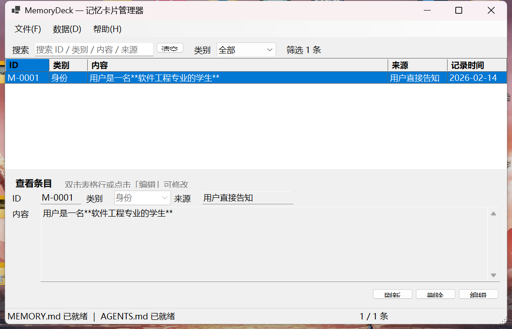

<div align="center">

# MemoryDeck

**记忆卡片管理器 —— 让你的长期记忆有一张看得见的脸**

用 C# / WinForms 手写的 Windows 桌面程序 · 单文件 259 KB · 零第三方依赖
以 Markdown 为唯一数据源，与你工作区的 AI 长期记忆双向同步



</div>

---

## 这是什么

`MemoryDeck` 是一个**本地记忆卡片管理器**。它针对一个很具体的问题：

> 用 Markdown 文件维护"跟 AI 协作时需要的长期记忆"时，
> 人得手动改表格、手动维护 ID、手动同步摘要给 AI 看。
> 改多了容易破表，改忘了 AI 就看不到。

MemoryDeck 把这个流程做成了图形界面：

- **左边是数据源**：`MEMORY.md` 里的一张标准 Markdown 表格，人可读、可手改、可进 Git
- **右边是操作台**：搜索、筛选、增删改、自动分配 ID，全部即时落盘
- **桥是自动的**：每次写入后自动重建 `AGENTS.md` 的摘要区，
  保证 AI 在新会话里加载到的记忆摘要永远是最新的

**没有数据库，没有云端，没有账号。** 打开一份 Markdown，改它。

---

## 核心特性

| 特性 | 说明 |
| --- | --- |
| **Markdown 即数据源** | 读写的就是你手写的那张表格。不用导入导出，随时手动改 |
| **手写区域零侵入** | 表格**之前**的说明、**之后**的维护约定，程序一律原样保留 |
| **AI 侧自动同步** | 每次写入后重建 `AGENTS.md` 摘要标记区，AI 下一轮就能读到 |
| **一键导出给网页版 AI** | 生成可直接粘贴的纯文本块（不是 Markdown 表格），带体量估算 |
| **克制的界面** | 表格只显 `ID / 类别 / 内容` 三列，来源与时间右键即看；为空时详情区自动收起 |
| **可选列不丢数据** | 界面下线的字段（如来源）与用户自建的列，只要文件里还有，写回时原样保留 |
| **类别可预设可自由** | 10 个预设类别（身份/偏好/项目/技术栈/目标/约束/技能/连接/资料/随手记），也可直接手输 |
| **自动备份** | 每次写入前复制一份到 `.memory-deck/backups`，最多保留 30 份，超出自动清理 |
| **原子写入** | 先写同目录临时文件再替换，断电/崩溃不会留下半截文件 |
| **外部变更跟随** | 每 1.5 秒检查文件指纹；你在编辑器改完保存，界面 2 秒内自动刷新 |
| **无损转义** | 内容里的竖线、反斜杠、emoji、全角字符都能原样往返，不破表 |
| **幂等写入** | 对同一份文件反复读写，结果字节级一致 |
| **一键自检** | `--selftest` 跑 103 项检查，含界面冒烟测试与崩溃回归 |
| **数据自愈** | `--repair` 规范化重写并校验"条目数无损"，格式乱了跑一次就恢复 |

---

## 快速开始

### 用现成的

1. 双击 `apps/MemoryDeck/publish/MemoryDeck.exe`
2. 数据目录默认回溯到仓库根（也就是 `MEMORY.md` 所在位置）
3. 开始增删改查

### 自己编译

需要 **.NET 10 SDK**（含 Windows Desktop 运行时）。

```powershell
cd apps\MemoryDeck
.\build.ps1              # 编译 + 自检 + 发布（产物在 publish\）
.\build.ps1 -TestOnly    # 只跑自检，不编译
.\build.ps1 -Install     # 发布后建桌面快捷方式、设置 MEMORYDECK_DATA
```

> `build.ps1` 带 UTF-8 BOM。**不要另存为无 BOM**，
> 否则 Windows PowerShell 5.1 会按 ANSI 解析中文注释并报一堆语法错误。

---

## 操作与快捷键

| 操作 | 快捷键 |
| --- | --- |
| 新增记忆（自动分配下一个 ID） | `Ctrl+N` |
| 编辑选中条目（或双击行） | `Ctrl+E` |
| 保存（内容框内直接保存） | `Ctrl+S` / `Ctrl+Enter` |
| 跳到搜索框 | `Ctrl+F` |
| 删除选中条目（会弹确认） | `Delete` |
| 重新加载文件 | `F5` |

搜索支持按 **ID / 类别 / 内容 / 来源** 模糊匹配，另有类别下拉做精确过滤。

---

## 命令行

```powershell
MemoryDeck.exe                      # 启动图形界面
MemoryDeck.exe --data <目录>         # 指定数据目录（含 MEMORY.md / AGENTS.md）
MemoryDeck.exe --open               # 用资源管理器打开数据目录
MemoryDeck.exe --selftest           # 数据层 + 界面自检（140 项），日志在 %TEMP%\MemoryDeck\
MemoryDeck.exe --selftest --verbose # 带每一项的 PASS 明细
MemoryDeck.exe --repair             # 规范化重写 + 校验数据无损（写前自动备份）
MemoryDeck.exe --env                # 打印显示器 / DPI / 窗口实测尺寸诊断信息
MemoryDeck.exe --help               # 帮助
```

### 导出给网页版 AI

```powershell
MemoryDeck.exe --export                     # 打到 stdout，可接管道
MemoryDeck.exe --export -o 记忆.txt          # 写入文件（UTF-8 无 BOM）
MemoryDeck.exe --export --with-time         # 带上记录时间
MemoryDeck.exe --export --no-preferences    # 不带 AGENTS.md 里的协作偏好
MemoryDeck.exe --export --no-header         # 不带说明头
MemoryDeck.exe --export --category 身份 --category 项目   # 只导出指定类别
```

界面里对应 **数据(D) → 导出给网页版 AI…**（`Ctrl+Shift+E`）。

### 数据目录是怎么定的

按优先级依次尝试，第一个命中即采用：

1. 命令行 `--data <目录>`
2. 环境变量 `MEMORYDECK_DATA`
3. exe 同级的 `memorydeck.config.json`
4. 从 exe 所在路径向上回溯，找带 `MEMORY.md` / `AGENTS.md` / `apps` 的仓库根
5. 当前工作目录

---

## 数据格式

`MEMORY.md` —— 唯一数据源：

```markdown
# MEMORY.md — 长期记忆条目

记忆按时间顺序累积。新增条目追加到表格末尾，不覆盖历史。

## 记忆条目

| ID | 类别 | 内容 | 来源 | 记录时间 |
| --- | --- | --- | --- | --- |
| M-0001 | 身份 | 用户是一名软件工程专业的学生 | 用户告知 | 2026-10-16 |
| M-0002 | 偏好 | 默认使用简体中文 | 用户告知 | 2026-10-16 |

## 记忆维护约定

（这一整段是你的手写区，程序不会碰）
```

程序只重写**表格本身**（表头、分隔行、数据行）。
表头之前的说明、表格之后的段落，读进来什么样，写回去什么样。

`AGENTS.md` —— AI 侧摘要，标记区由程序维护：

```markdown
<!-- MEMORY-DECK:SUMMARY:BEGIN -->

## 用户画像（长期记忆）

最后更新：2026-10-16 16:59 ｜ 共 2 条 ｜ 由 MemoryDeck 自动维护

| ID | 类别 | 内容 | 记录时间 |
| --- | --- | --- | --- |
| M-0001 | 身份 | ... | 2026-10-16 |

<!-- MEMORY-DECK:SUMMARY:END -->
```

标记区之外的内容（比如协作偏好），程序同样不动。

---

## 项目结构

```
.
├── AGENTS.md                   # AI 侧长期记忆摘要（程序维护标记区）
├── MEMORY.md                   # 唯一数据源：记忆条目表
├── docs/
│   └── env-troubleshooting.md  # 环境踩坑记录（NuGet / 代理 / DPI）
└── apps/MemoryDeck/
    ├── MemoryDeck.csproj       # .NET 10 / WinForms / 单文件发布
    ├── app.manifest            # PerMonitorV2 DPI 感知 + 长路径支持
    ├── nuget.config            # 清掉本机残留的 NuGet fallback 目录
    ├── build.ps1               # 一键编译 + 自检 + 发布 + 安装
    ├── acceptance.ps1          # 验收对账（-Baseline / -Compare）
    ├── snapshot.ps1            # DPI 感知的窗口截图
    ├── README.md               # 组件级文档
    ├── docs/mainwindow.png     # 界面截图
    └── src/
        ├── Program.cs          # 入口与命令行解析
        ├── ConsoleBridge.cs    # WinExe 的控制台桥接（挂父控制台 + 日志双写）
        ├── SelfTest.cs         # 85 项自检
        ├── Repair.cs           # --repair 自愈模式
        ├── EnvDump.cs          # --env 环境诊断
        ├── Core/
        │   ├── Models.cs           # MemoryEntry / RepoSnapshot / WriteResult
        │   ├── StorageConfig.cs    # 数据目录推断 + 原子读写 + UTF-8 无 BOM
        │   └── MemoryRepository.cs # Markdown 表格解析 / 写入 / 摘要同步
        └── Ui/
            └── MainForm.cs     # 主窗口
```

约 2900 行 C#（含 900 行自检）。

---

## 设计取舍

**为什么不直接给 Markdown 套个编辑器？**

因为要解决的不是"编辑"，是"编辑完之后 AI 能不能读到"。
所以核心是 `AGENTS.md` 摘要区的自动重建——
这一步把"人维护的记忆"变成"AI 每轮都能加载的上下文"。

**为什么坚持 Markdown 而不是 SQLite？**

- 手改友好：出问题时你能用记事本救它
- Git 友好：每次改动都是可读的 diff
- 无依赖：没有二进制格式、没有迁移、没有版本兼容问题
- AI 友好：我可以直接读，不用你导出

**为什么只重写表格、保留其余内容？**

因为那个文件里通常还有你写给人看的东西（维护约定、说明、TODO）。
一个"顺手帮你格式化"的程序如果把那些吞掉，就是数据损失。
这条行为有回归用例守着（见下文）。

---

## 测试

覆盖 **140 项**，分 16 组：

| 组 | 覆盖内容 |
| --- | --- |
| 01–02 | 空目录、首次写入、文件生成、编码无 BOM |
| 03 | 重新加载、ID 排序、字段完整性、**外部修改后指纹变化** |
| 04 | ID 连续自增、下一个 ID 推断 |
| 05 | 竖线/换行/全角字符转义、空内容与超长内容拒绝 |
| 06 | 更新语义（ID 与时间不变）、删除、不存在条目的错误处理 |
| 07 | **增删往返字节级一致**、AGENTS.md 同步幂等、标记不重复插入 |
| 08 | 无标记区的旧文件兼容（保留原文并补标记区） |
| 09 | Emoji 混排、反斜杠、1900 字长内容 |
| 10 | 乱码输入容错（无表格 / 空文件 / 仅分隔行） |
| 11 | 实际数据目录只读校验 |
| 12 | **界面冒烟**：窗口构造、布局、尺寸、外部变更后重载不崩溃 |
| 13 | **手写区保留**、连续写入不累积空行 |
| 14 | **类别目录**：预设完备性、空数据仍有选项、自定义类别不被冲掉 |
| 15 | **可选列保留**：已下线的来源列、用户自建的列，写回时数据不丢 |
| 16 | **导出格式**：不含 Markdown 表格与标记注释、摘要不混入、类别分组与排序、选项开关、按类别筛选、空输入、多行压平 |

其中 `Test12` 的"外部变更后重载"覆盖 5 个边界：
追加一行 / 删到一行不剩 / 再加回来 / 文件被外部删除 / 文件被写坏。

运行：

```powershell
apps\MemoryDeck\publish\MemoryDeck.exe --selftest --verbose
# 或
apps\MemoryDeck\acceptance.ps1
```

> 自检在临时目录里做真实读写，**不触碰任何用户数据**。

---

## 开发过程中修掉的三个崩溃

这个项目初期"数据层全绿但双击没窗口"，三个原因都进了回归用例。

### 1. `InvariantGlobalization` 废掉了中文文化

Release 配置里开了 `InvariantGlobalization=true`，导致 `new CultureInfo("zh-CN")`
直接抛 `CultureNotFoundException`。程序一启动就死。

**修**：关掉该开关；`UiCulture.Install()` 加异常兜底，退化到系统文化也能跑。

**为什么自检没发现**：`--selftest` 入口**根本不初始化界面**，测不到。

### 2. `Panel2MinSize` 的 setter 会顺手重算 `SplitterDistance`

```
System.Windows.Forms.SplitContainer.set_SplitterDistance(Int32 value)
System.Windows.Forms.SplitContainer.ApplyPanel2MinSize(Int32 value)
```

容器还没有尺寸时设一个较大的最小尺寸，内部重算会抛
`InvalidOperationException: SplitterDistance 必须在 Panel1MinSize 和 Width - Panel2MinSize 之间`。

**修**：构造期只用安全范围内的最小尺寸，精确分隔位置推迟到 `OnLoad`。

### 3. 外部修改文件触发重载时直接杀进程

**复现**：启动程序 → 往 `MEMORY.md` 追加一行 → 等 2 秒 → 进程消失。

**根因**：重载时表格先被清空，`SelectionChanged` 回调在这个瞬间访问越界的行；
异常从 WinForms 事件回调逃逸，而未捕获的 UI 事件异常会**直接终止进程**。

**修**：统一异常护栏 `RunGuarded` + 界检查；选中条目改为按 ID 查找而非行索引。

这三个 bug 有个共同教训：

> **"单元测试全绿"和"程序能跑"是两件事。**
> 界面层必须有真的构造一次窗口的冒烟测试，
> 否则数据层再绿也拦不住"双击闪退"。

---

## 环境踩坑记录

详见 [`docs/env-troubleshooting.md`](docs/env-troubleshooting.md)，包含三条实测结论：

1. **NuGet**：Visual Studio 残留的 `fallbackPackageFolders` 指向已删目录时，
   `.csproj` 属性无效，必须项目级 `nuget.config` 用 `<clear />`
2. **代理**：`gh` 和 `git` 需求**相反**——`gh` 走系统代理最稳（6/6），
   额外设 `HTTPS_PROXY` 反而降到 1/4；`git` 则**必须**显式配 `http.proxy`（3/3 vs 0/3）
3. **DPI**：非 DPI 感知的进程读窗口尺寸会被系统虚拟化（1120×720 被读成 747×480），
   排查显示问题要用 `--env` 或先声明 `SetProcessDpiAwarenessContext`

第 2 条的方法论值得单说：

> **不要用 A 工具的现象去推断 B 工具的行为。**
> 先让目标程序自己带 debug 说话（`GH_DEBUG=api`），再做受控对照实验（只改一个变量、跑多次取成功率）。

---

## 下一步

[`docs/ROADMAP.md`](docs/ROADMAP.md) 记录了 v1.0.0 之后的完善方向，
按"日常摩擦 → 数据规模 → 工程稳固"分了三梯队，每条附造价与风险。

当前最该补的缺口是 **单实例锁**——同一数据目录开两个实例会互相覆盖，
这是数据安全问题而非体验问题。

---

## 环境要求

- Windows 10 / 11（x64）
- .NET 10 桌面运行时（`Microsoft.WindowsDesktop.App`）
  - 不想装运行时？把 `MemoryDeck.csproj` 里 `SelfContained` 改成 `true` 重新发布（产物约 150 MB）
- 编译需要 .NET 10 **SDK**

---

## License

未指定。要开源请自行添加 `LICENSE`。
